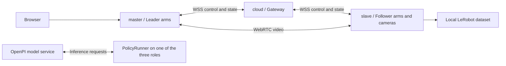

# Remote Teleop

**English** | [简体中文](README.zh-CN.md)

A three-role platform for remote teleoperation and human-in-the-loop (HIL) data collection. Clone the same repository on each machine, then install and run its role from a single Python package. The web interface ships with the package; no Node.js build is required.

| Role | Command | Responsibilities | Installation |
| --- | --- | --- | --- |
| cloud | `remote-teleop cloud` | Authentication, message routing, optional policy runner | `.[cloud]`; no Torch, ROS, or camera libraries by default |
| master (client in the protocol) | `remote-teleop master` | Operator UI, leader input, follower feedback, video display | `.[master]`, including WebRTC and OpenCV |
| slave (robot in the protocol) | `remote-teleop slave` | Follower control, cameras, safety state machine, recording | `.[slave]`, including media, inspection, and full recording dependencies |



The three roles are deployment processes. `policy.runner_location=robot|client|cloud` selects which role calls the external model service. The installation scripts do not install model weights or start an OpenPI inference server.

## Install each role

Requirements: Linux, Git, Python 3.10+, pip, and venv. For ROS 2 Humble hardware deployments, use Python 3.10 with the matching ROS Python ABI. On each machine:

```bash
git clone https://github.com/SII-abw/remote_teleop.git
cd remote_teleop
# Run only the command for this machine's role:
bash scripts/install.sh cloud
# Or: bash scripts/install.sh master
# Or: bash scripts/install.sh slave
```

The installer creates `.venv-cloud`, `.venv-master`, or `.venv-slave`, installs the selected dependencies, and validates the simulation configuration. It does not start any services. To use an existing environment, install with a command such as `python -m pip install '.[master]'`, then set `TELEOP_PYTHON=/absolute/path/bin/python` when starting the role.

The recording writer, OpenPI client, Sii / Feetech leader, and motor bus implementations are built into `src/remote_teleop/components/` and installed with this package. No additional source checkout or source-path configuration is required.

| Feature | Host | Installation |
| --- | --- | --- |
| v3 / H.264 recording | slave | `bash scripts/install.sh slave`; recording dependencies are included |
| OpenPI inference requests | Host selected by `runner_location` | Add `--policy` to its installation command |
| Sii / Feetech serial leader | master | `bash scripts/install.sh master --serial` |
| ROS leader / follower | master / slave | Install ROS 2 and the device drivers; set `TELEOP_ROS_SETUP` before starting |

Recording dependencies include Torch, Torchvision, Datasets, PyArrow, and video encoding libraries. Initial installation time depends on the network and platform. A gateway-only cloud installation does not include these libraries; a serial leader installation also does not require the training framework. See [built-in components](docs/BUILTIN_COMPONENTS.md) for the dependency breakdown (Chinese).

## Configure and start the roles

See the **[distributed deployment guide](docs/DISTRIBUTED_DEPLOYMENT.md)** for TLS, ROS, credential distribution, updates, and troubleshooting. Per-host checklists are available for [cloud](docs/roles/cloud.md), [master](docs/roles/master.md), and [slave](docs/roles/slave.md). These detailed guides are currently in Chinese.

Generate a single matching configuration and credential bundle on a trusted machine. Do not independently generate three unrelated sets of tokens:

```bash
.venv-cloud/bin/python scripts/prepare_deployment.py --output state/deployment
```

Distribute `ROLE.json` and `credentials-ROLE.json` **only to their matching host**, using the following paths. Replace `ROLE` with `cloud`, `master`, or `slave`:

```text
configs/local/ROLE.json
state/credentials-ROLE.json          # chmod 600
```

The default template uses loopback simulation for verification on one machine. For three-machine deployments, configure the WSS gateway, certificates, and network, or follow the guide's SSH tunnel procedure. All three roles must use the same code version and matching shared configuration contracts.

```bash
# Run each command on its corresponding host, from the repository root:
bash scripts/run.sh cloud
bash scripts/run.sh slave
bash scripts/run.sh master
```

Open the master's `http://127.0.0.1:8810` and log in with the token whose role is `ui` in the master's credential file. Tokens expire after 24 hours by default. Motion requires explicit operator enable and start actions. Closing the UI, timeouts, or disconnection causes a safe hold; reconnection does not automatically resume motion. The default slave installation includes the writer required for HIL recording.

## Development and verification

```bash
bash scripts/install.sh master --dev
TELEOP_TEST_PYTHON="$PWD/.venv-master/bin/python" bash scripts/check.sh
# The slave environment includes recording dependencies; run the full stack locally:
PYTHONPATH=src .venv-slave/bin/python tests/integration_smoke.py
# Installed-package acceptance with external source imports blocked and three-camera recording:
# Install the policy and serial extras into this environment first.
.venv-slave/bin/python tests/standalone_components_smoke.py
```

Simulation acceptance tools use temporary credentials, loopback ports, and simulated hardware. Two existing homing tests currently fail in the full regression suite; see the [repository validation record](docs/REPOSITORY_VALIDATION.md). Hardware integration and the complete stopping chain still require on-site acceptance; see [hardware acceptance](docs/HARDWARE_ACCEPTANCE.md).

```text
src/remote_teleop/       Role runtimes, control protocol, adapters, web UI
  components/           Built-in writer, OpenPI, Sii/Feetech, supporting modules
configs/                Simulation, ROS, and serial configuration templates
scripts/install.sh      Install a role into its own virtual environment
scripts/run.sh          Start a role; retains the existing siinuc Conda fallback
scripts/prepare_deployment.py  Generate matching configs and scoped credentials
scripts/check.sh         Regression checks
docs/roles/             Per-role deployment checklists
deploy/                 systemd examples; adjust site-specific paths before use
tests/                  Unit tests and simulation acceptance checks
```

Machine-local files in `configs/local/`, `configs/siinuc/`, `state/`, and the root `datasets/` directory, along with virtual environments, certificates, and tokens, are excluded from Git. The repository contains platform source, generic configuration templates, tests, and documentation.

Further reading (Chinese): [operations and data contract](docs/OPERATIONS.md) · [architecture](docs/ARCHITECTURE.md) · [arm configuration](docs/ARM_ACCESS_CONFIGURATION.md) · [homing](docs/HOMING.md) · [historical siinuc deployment](docs/DEPLOYMENT_SIINUC.md) · [中文 README](README.zh-CN.md).
