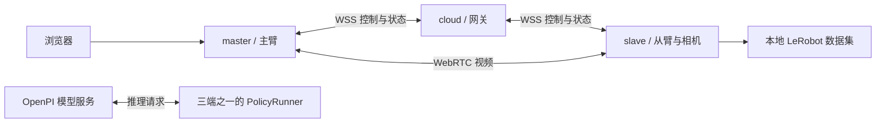

# Remote Teleop

[English](README.md) | **简体中文**

三端远程遥操与人在回路（HIL）采集平台。一个独立 Git 仓库、一个 Python 包，三台机器分别拉取源码，按角色安装和运行。网页随包分发，无需 Node.js 构建。

| 部署端 | 命令 | 职责 | 安装内容 |
| --- | --- | --- | --- |
| 云端 cloud | `remote-teleop cloud` | 认证、消息路由，可选策略 Runner | `.[cloud]`，默认不安装 Torch、ROS、相机库 |
| 操作端 master（协议名 client） | `remote-teleop master` | 操作网页、主臂输入、从臂反馈和视频显示 | `.[master]`，包含 WebRTC / OpenCV |
| 机器人端 slave（协议名 robot） | `remote-teleop slave` | 从臂控制、相机采集、安全状态机、数据录制 | `.[slave]`，包含媒体、数据检查和完整录制依赖 |



三端指平台的三个部署进程。`policy.runner_location=robot|client|cloud` 决定哪端请求外部模型服务；平台安装脚本不安装模型权重或启动 OpenPI 模型服务。

## 各端快速安装

要求 Linux、Git、Python 3.10+、pip 和 venv。ROS 2 Humble 真机环境建议使用匹配 ROS Python ABI 的 Python 3.10。三台机器分别执行下列操作：

```bash
git clone https://github.com/SII-abw/remote_teleop.git
cd remote_teleop
# 每台机器只执行自己的角色：
bash scripts/install.sh cloud
# 或 bash scripts/install.sh master
# 或 bash scripts/install.sh slave
```

脚本分别创建 `.venv-cloud`、`.venv-master`、`.venv-slave`，安装选定角色并校验模拟配置。不会启动服务。也可以使用已有虚拟环境手动执行 `python -m pip install '.[master]'` 等命令，然后通过 `TELEOP_PYTHON=/绝对路径/bin/python` 指定启动解释器。

录制 writer、OpenPI 客户端、Sii / Feetech 主臂与电机总线均已合并在 `src/remote_teleop/components/`，随当前包安装，不再需要额外源码仓库或源码路径配置。

| 功能 | 需要补充的机器 | 安装方式 |
| --- | --- | --- |
| v3 / H.264 录制 | slave | `bash scripts/install.sh slave`，默认安装录制依赖 |
| OpenPI 策略请求 | `runner_location` 指定的那一端 | 安装时加 `--policy` |
| Sii / Feetech 串口主臂 | master | `bash scripts/install.sh master --serial` |
| ROS 主臂 / 从臂 | master / slave | 系统安装 ROS 2、启动对应驱动，启动前指定 `TELEOP_ROS_SETUP` |

slave 的录制依赖包含 Torch、Torchvision、Datasets、PyArrow 和视频编码库，首次安装耗时取决于网络与平台。cloud 默认只做网关时不安装这些库；Sii 主臂单独使用 `--serial` 也不需要训练框架。包内组件与依赖划分见 [内置组件说明](docs/BUILTIN_COMPONENTS.md)。

## 配置并启动三端

完整步骤、TLS、ROS、凭据分发、更新与排障见 **[三端部署指南](docs/DISTRIBUTED_DEPLOYMENT.md)**；按机器执行的清单见 [cloud](docs/roles/cloud.md)、[master](docs/roles/master.md)、[slave](docs/roles/slave.md)。

先在一台受控机器生成一次配置与凭据，切勿在三端分别生成三组随机令牌：

```bash
.venv-cloud/bin/python scripts/prepare_deployment.py --output state/deployment
```

将生成目录中 `ROLE.json` 和 `credentials-ROLE.json` **仅分发到对应机器**，放置如下（把 `ROLE` 替换为 cloud、master 或 slave）：

```text
configs/local/ROLE.json
state/credentials-ROLE.json          # chmod 600
```

默认模板是回环网络模拟配置，适合同机验证；三机部署请按指南设置 WSS 网关、证书及网络，或使用指南中的 SSH 隧道。三端使用相同代码版本和公共配置契约。

```bash
# 各自在所属机器 / 项目目录执行：
bash scripts/run.sh cloud
bash scripts/run.sh slave
bash scripts/run.sh master
```

浏览器访问 master 的 `http://127.0.0.1:8810`，以 master 凭据文件中 `role=ui` 的令牌登录。令牌默认 24 小时有效。启动后仍需人工使能和开始任务；关闭页面、超时或断线会进入安全保持，重连不会自动恢复运动。slave 默认安装已包含 HIL 录制所需的 writer。

## 开发与验证

```bash
bash scripts/install.sh master --dev
TELEOP_TEST_PYTHON="$PWD/.venv-master/bin/python" bash scripts/check.sh
# slave 环境已包含录制依赖；以下测试可在同机运行：
PYTHONPATH=src .venv-slave/bin/python tests/integration_smoke.py
# 校验已安装包，强制禁止外部源码导入，包含 3 路视频录制：
.venv-slave/bin/python tests/standalone_components_smoke.py  # 需先额外安装 policy、serial extras
```

模拟集成工具只使用临时凭据、回环端口和模拟硬件。当前完整回归有两项既有回零测试失败，详见 [仓库验证记录](docs/REPOSITORY_VALIDATION.md)。真机接入和完整停止链仍须现场验收，参见 [硬件验收](docs/HARDWARE_ACCEPTANCE.md)。

```text
src/remote_teleop/       三端运行时、控制协议、适配器、网页
  components/           内置 writer、OpenPI、Sii/Feetech 及辅助模块
configs/                模拟 / ROS / 串口配置模板
scripts/install.sh      按角色安装到独立虚拟环境
scripts/run.sh          按角色启动，兼容 siinuc 现有 Conda 环境
scripts/prepare_deployment.py  生成三端配置与最小角色凭据
scripts/check.sh         回归检查
docs/roles/             各端部署清单
deploy/                 systemd 参考模板（含现场路径，使用前修改）
tests/                  单元测试与模拟集成检查
```

`configs/local/`、`configs/siinuc/`、`state/`、`datasets/`、虚拟环境、证书和令牌不进入 Git；现场文件保留在机器上。独立仓库只包含平台源码、通用配置模板、测试与文档。

更多资料：[操作与数据契约](docs/OPERATIONS.md) · [架构与复用边界](docs/ARCHITECTURE.md) · [主从臂配置](docs/ARM_ACCESS_CONFIGURATION.md) · [回零](docs/HOMING.md) · [siinuc 历史部署](docs/DEPLOYMENT_SIINUC.md) · [English](README.md)。
