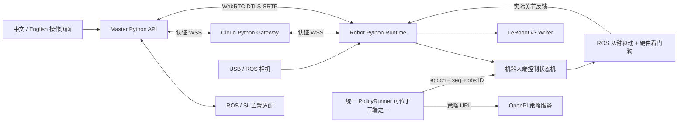
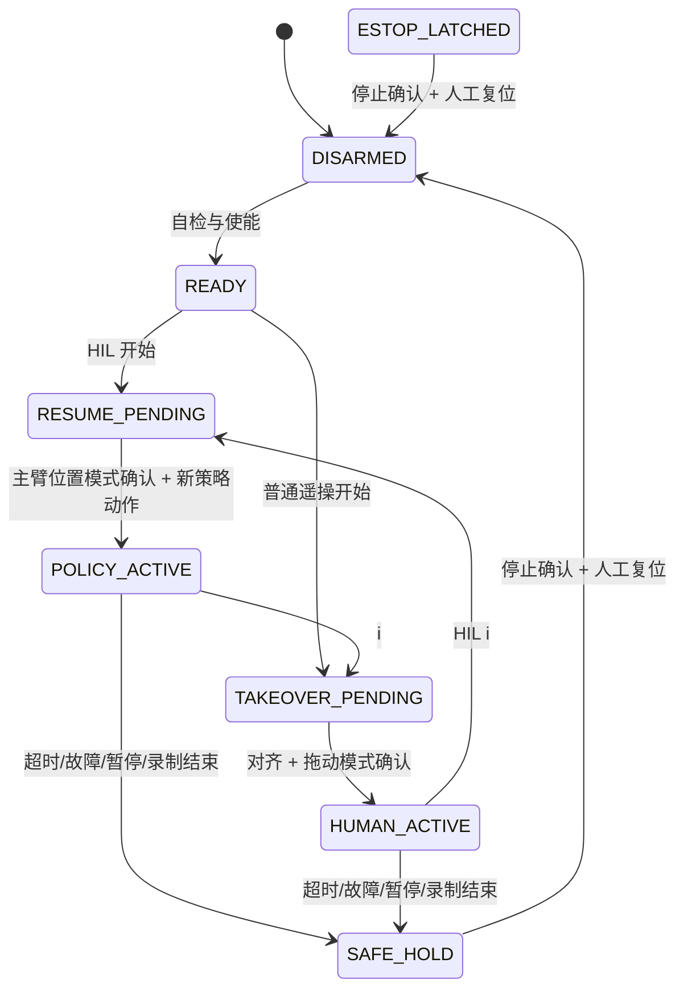

# 架构

控制状态机不依赖 ROS、WebSocket、相机或推理库，可以用可控时钟做确定性测试。只有 robot runtime 调用驱动 command。云端是认证和消息路由边界；master 是人类输入、实际从臂反馈、用户交互边界。

图中的硬件看门狗是生产部署需要由底层驱动/控制器提供的能力。当前 siinuc 原 ARX 桥未暴露独立停止确认；`position_hold` 兼容模式仅实现软件保持和实测静止检查，不宣称已实现硬件看门狗。真机监看与运动验收分离：未验收时可以启动传感器，但控制状态机拒绝使能。

控制线程、独立 watchdog 线程、异步网络、相机采集、策略请求和数据写入各有明确所有者。命令/图像只保存最新条目，控制事务队列有界，RPC 并发数和入站速率有上限。停止消息优先；状态变更令旧动作的 epoch 失效。RPC 控制操作也绑定 epoch，避免排队的旧复位或旧接管操作影响新的控制状态。

配置采用 Pydantic 严格字段和范围检查，JSON 原子替换，文件锁和内容 hash 防止并发覆盖，运行配置与保存配置分离。三角色连接检查共同控制契约 hash。密钥不进配置表单，通过文件和环境变量引用；UI 会话使用 HttpOnly/SameSite cookie 和 Origin/自定义请求头保护。数据检查限制在配置根目录内并拒绝路径越界。

## 内置组件边界

录制、策略通信和串口主臂实现均随包安装：

| 组件目录 | 作用 |
| --- | --- |
| `components/datasets` | v3 metadata、Parquet、H.264、Episode 结果和图片写入 |
| `components/remote_policy` | OpenPI MessagePack、pi05 预处理、动作块和队列 |
| `components/teleoperators/sii_arm_leader` | 主臂编码器、串口关节映射和反馈 |
| `components/motors` | Feetech 电机总线、协议与控制表 |
| `components/utils` / `components/configs` | 必需的类型、连接状态、终端及数据工具 |

内部组件全部使用 `remote_teleop.components` 命名空间，不从其他项目定位或导入源码。网关、模拟模式和 ROS 主臂在未启用对应功能时不加载录制与串口依赖。硬件适配层继续负责接管前目标预装、模式确认、标定姿态检查；录制层继续负责有界队列、审计和未完成标记。

第三方 Python 依赖由 extras 按功能安装，ROS 与设备驱动按机器准备。模型权重与 OpenPI 推理服务独立部署。详见 [内置组件说明](BUILTIN_COMPONENTS.md)。

## 状态转换

任意状态均可接收停止并进入 ESTOP_LATCHED。复位不会启动运动。切换准备阶段不下发新运动；拒绝新策略动作直到主臂模式准备确认。普通遥操不允许通过 i 自动进入策略。
