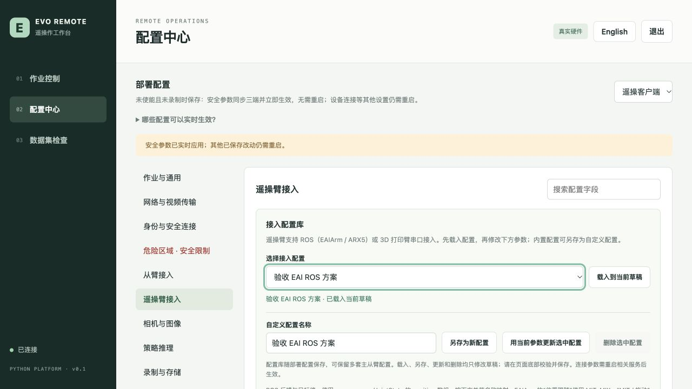

# 主从臂接入规范与配置

2026-10-25，检查位置：`siinuc:/home/siinuc2/Evo-RL/remote_teleop`。

## 检查结论

原实现部分符合接入原则：真机从臂已限制为 ROS；遥操臂已有 ROS 与 Sii/Feetech 串口适配器；ROS 已支持关节读取和位置目标下发。主要缺口是未显式区分 EAI 与 ARX5 接入方案，遥操臂借用从臂的关节名称和 ROS domain，模式消息类型与控制值固定，且前端缺少可持久保存的多方案管理。本次将这些差异纳入统一的配置模块。

| 角色 | 真机接入 | 内置方案 | 自定义方案 |
|---|---|---|---|
| 从臂 `robot` | ROS | EAI Arm、ARX5 | 支持多个，独立命名、保存、更新、删除和选用 |
| 遥操臂 `leader` | ROS 或 3D 打印臂串口 | EAI Arm ROS、Sii/Feetech 3D 打印臂 | 支持多个；ROS 驱动可选 EAI Arm 或 ARX5 |

`sim` 仅用于明确开启 `general.simulation=true` 的模拟部署。真机配置拒绝模拟从臂和模拟遥操臂。

## 前端操作

在“配置中心 → 从臂 / 遥操臂”选择内置方案或已保存的自定义方案，按实际接线修改字段。可将当前表单另存为一个有名称的自定义方案，或更新、删除已有自定义方案。内置方案作为模板保留。

方案库位于配置文件的 `arm_profiles.robot` 和 `arm_profiles.leader`，各自保存多个 `{id, name, config}`。`robot`、`leader` 顶层字段保存实际选用的接入参数；`selected_robot`、`selected_leader` 记录选择。方案库通过既有“保存配置”流程持久写入并同步三端，浏览器重载和进程重启后仍保留。

只修改方案库不要求重启。选用方案或修改实际接入参数后，需要在未使能且未录制时保存，再重启三端平台使设备接入变更生效。模式、话题、关节映射等接入设置不会在运动中直接替换。三端的有效接入参数纳入控制契约，配置不一致时拒绝运动。

现场原有 EAI 遥操臂和 ARX 从臂参数会作为“现场遥操臂配置”“现场从臂配置”保留，包含原有夹爪换算和模式确认方式。新增模板不会覆盖实际设备接线。

## ROS 接口

本平台的标准关节边界为 `sensor_msgs/msg/JointState`，读取和目标写入均使用 `position`。每臂七个量：六个关节和一个夹爪；内部固定左臂七维、右臂七维。关节角使用弧度，夹爪单位由驱动桥及配置共同确定。

可在前端配置：

- 每个角色独立的 ROS domain；驱动类型 `eaiarm` / `arx5`。
- 每臂状态话题、位置目标话题、七个关节名称及排列顺序。
- 遥操臂的方向、偏移和夹爪反馈换算；从臂夹爪反馈的比例和偏移。
- 可选的模式切换开关、命令及反馈话题、消息类型、位置跟随值、MIT/拖动值与确认方式。

状态回调根据各自配置的关节名称提取数据，目标消息写入同一套名称。从臂和遥操臂可以使用不同名称和不同 domain。关节读取与位置目标写入是接入的基本能力，模式切换不再是所有 ROS 驱动的强制能力。

### 模式切换

模式命令支持 `JointState`、`std_msgs/Bool`、`std_msgs/Int32`。`mode_position_value` 与 `mode_mit_value` 对应驱动的实际协议。启用切换时须提供有效命令及确认方式；关闭切换时不创建或使用模式通道。位置目标下发独立于模式通道：关闭模式切换的遥操臂仍可读取关节和发送目标，进入目标跟随前仍检查新鲜状态并预载当前位置。此时驱动的实际控制模式由设备或外部控制器管理，平台只切换逻辑采集／跟随状态。

当前 OpenEAI 驱动的模式消息为 `JointState.position=[值, 0]`：0 是 MIT_MIX 目标跟随，1 是 MIT_DRAG 拖动。这里“位置模式”表示平台的目标跟随能力，不意味着驱动使用原生 POS 枚举。OpenEAI 的既有 `openeai_graph` 确认方式按驱动目标话题回显发布器行为确认；它只适用于已核对的 OpenEAI 驱动。其他驱动使用显式确认话题。

停止策略和模式切换分别配置。现场 ARX 的 `position_hold` 仍表示软件位置保持，其确认仅表示反馈连续静止，不能据此宣称驱动已断力矩。

### ARX5 驱动边界

现场 ARX 接入经过既有 `JointState` 桥：状态 `/{left,right}/ARX_joint_states`，目标 `/{left,right}/ARX_joint_targets`。原生 ARX 控制器的 `arx5_arm_msg/RobotStatus`、`RobotCmd` 自定义消息需要桥接到上述标准接口；本次模板直接复用现场桥，不声称直接兼容任意原生消息。

当前桥的夹爪目标比例为 50、反馈比例为 1，现场从臂适配层保留 `gripper_feedback_scale=0.02`。自定义方案须按实际桥配置核对该值；本次没有做物理行程标定。

## 3D 打印遥操臂

沿用 Sii/Feetech 串口适配器。前端可配置左右串口、波特率、七个电机 ID、方向、偏移、夹爪范围与标定文件路径。串口连接要求已有显式保存的标定文件；`passive_supported` 和 `serial_support_validated` 仍需根据现场支撑和无力矩模式确认。模板保留未验收状态，选用模板本身不表示已完成硬件验收。

## 部署和验证

迁移工具 `scripts/normalize_arm_profiles.py` 默认只校验，指定 `--write` 才写入。它为原有接入增加显式参数，并将有效主从配置保存为现场自定义方案；不会连接 ROS、打开串口或启动服务。部署前需备份实际配置及恢复默认基线。

验证涵盖旧配置兼容、角色及方案校验、关节名称映射、独立 domain、可选模式通道及确认、无运动启动、方案库同步和重启语义。三进程方案验收在回环模拟环境运行；ROS 契约使用隔离 domain。具体通过项见同目录验收记录。

本次检查时三个平台用户服务均已停止。部署保留这一状态，不启动底层驱动或真机运动。

验收结果：现场 `evo-rl`、`remote-controller` 两个环境各 78 项单元测试通过；前端 Node 配置操作测试通过；隔离 ROS domain 218 的 DDS 关节读写、被动启动、位置保持及模式往返通过。三进程模拟配置库验收通过；HIL 回归保存 301 帧，S0/S1/S2 分别为 200/100/1，数据集格式兼容。详见 [本次验收记录](arm-access-acceptance-20261025.json)。

